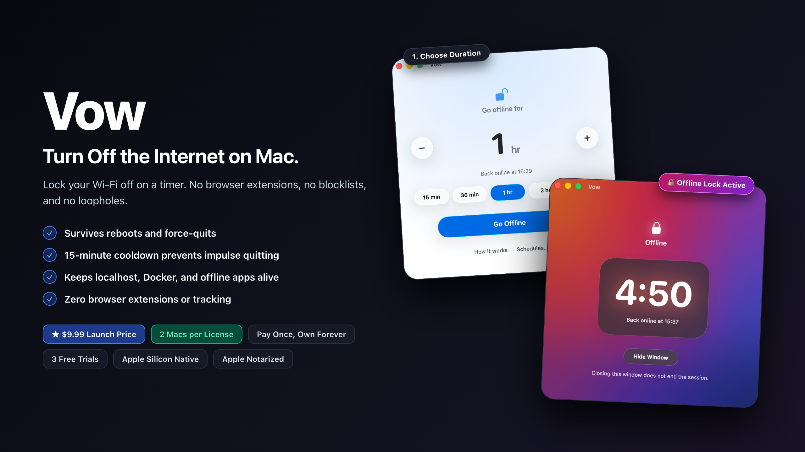
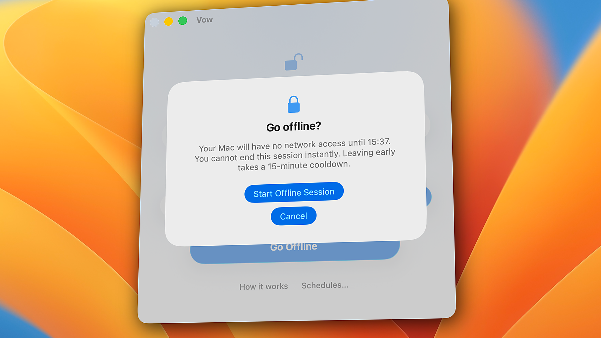

# Vow

### Turn off the internet on Mac.

Lock your Mac offline on a timer. No browser extensions, no bypassable blocklists, and no instant cancel button.

 

&nbsp;

  

[Download Free Trial (3 Sessions)](https://github.com/yourarnav/vow/releases/download/v1.0.7/Vow-1.0.7.dmg) &nbsp;•&nbsp; [Purchase License ($9.99)](https://calibrestudio.gumroad.com/l/vow) &nbsp;•&nbsp; [Report an Issue](https://github.com/yourarnav/vow/issues)

---

## Why Vow?

Block YouTube, and you open Reddit. Block Reddit, and you check email. Blocklists fail because the modern internet is designed to defeat willpower.

**Vow does one thing:** it cuts network access at the system level for the exact duration you set. When the timer starts, your Mac stays offline until the countdown reaches zero.

---

## Key Features

  

 

- **Survives Reboots:** Powered by a privileged `SMAppService` root LaunchDaemon. Quitting the app or rebooting your Mac will not restore the internet.
- **15-Minute Cooldown:** No instant cancel button. If an urgent task arrives, you must request an early unlock and wait out a mandatory 15-minute countdown. This completely eliminates impulsive quitting.
- **Localhost & Docker Preserved:** Local development environments (`127.0.0.1`, `localhost`, local dev servers, Docker containers) and local network printers stay completely operational. Build and write software offline without interruption.
- **Recurring Schedules:** Set automatic deep-work windows (e.g. Mon–Fri, 9:00 AM – 11:00 AM) so lockdown happens on autopilot.
- **Zero Loophole Enforcement:** Enforces across all physical and wireless network interfaces (Wi-Fi, Ethernet, iPhone USB tethering).
- **Safe Fail-Open Design:** If state ever corrupts or power cuts out, Vow fails open and restores full connectivity safely. It will never brick your Mac.

---

## Pricing

- **$9.99 One-Time Purchase**
- **Pay once, own forever** (No subscriptions)
- One license covers up to **2 of your personal Macs** (e.g. desktop + laptop)
- Includes lifetime updates via built-in Sparkle auto-updater

[Buy License on Gumroad →](https://calibrestudio.gumroad.com/l/vow)

---

## System Requirements

- **OS:** macOS 26.0 or later (including macOS 27+)
- **Architecture:** Apple Silicon (all M-series Macs)
- **Permissions:** Administrator password (one-time prompt to register the privileged helper)

---

## Privacy & Security

- **Apple Notarized:** Verified, scanned, and ticketed by Apple Gatekeeper.
- **Hardened Runtime:** Compiled with Apple's hardened runtime entitlements.
- **Zero Telemetry:** No analytics, no tracking, and no external network calls except Gumroad license verification and Sparkle update checks.

---

## Feedback & Issues

Found a bug or have a feature request? Please [open an issue](https://github.com/yourarnav/vow/issues) on GitHub.

For order or license support, contact: **heycalibrestudio@gmail.com**
